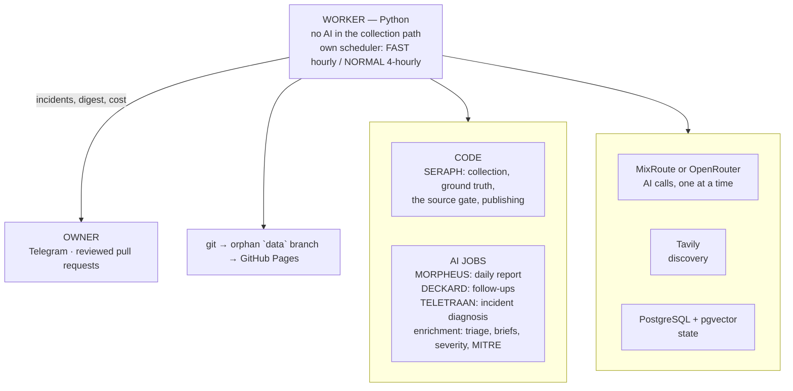

# CyberPulse-AI

**An autonomous Australia-first cyber security + AI intelligence organisation**

`COLLECT → NORMALISE → CORRELATE → VERIFY → ENRICH → SCORE → PUBLISH → MONITOR → SELF-HEAL`

**[Live site →](https://happycode0.github.io/CyberPulse-AI/)** &nbsp;·&nbsp;

---

## What this is

Not a news aggregator. A small, permanently-running intelligence pipeline whose jobs each carry
a named persona.

Deterministic Python collects from dozens of live-validated sources on three cadences and
resolves many reports into **one canonical event**. Ground truth comes from CISA KEV, CVE.org,
CISA Vulnrichment, EPSS, OSV and MITRE ATT&CK — never from a model's memory. AI is an enrichment
layer that judges severity, extracts entities, reasons about Australian relevance and reconciles
conflicting evidence, always from retrieved facts, never recalled from training data.

Every job runs in one Python worker, on its own schedule. When a source breaks, the watchdog opens
an incident, an AI job suggests the likely cause and fix, and the owner makes the change as a
reviewed pull request. Until 31 October 2026 a crew of AI agents in
[Paperclip](https://github.com/paperclipai/paperclip), a separate control plane, did the
judgment work. Each agent run read about a million tokens to do what one worker call does in a
few thousand, so the jobs moved into the worker and Paperclip was retired.

The public site is a static HUD on GitHub Pages that publishes only canonical, evidence-linked
intelligence — and says plainly that it's a snapshot of the last completed run, not a live feed.

---

## Architecture

| | |
|---|---|
| **Deterministic layer** | Python worker — collection, resolution, scoring, publishing, scheduling |
| **Inference** | MixRoute or OpenRouter (`AI_PROVIDER`), cheapest capable model first. Hard monthly cap, output price ceiling enforced in code |
| **Discovery** | Tavily, free tier |
| **State** | PostgreSQL + pgvector |
| **Public site** | Static HTML/CSS/JS on GitHub Pages — no build step, no secrets |

The collection path has no AI: the worker keeps collecting, scoring and publishing on its own
schedule even if every AI call fails. The AI jobs add judgment on top — briefs, Australian
relevance, a daily report, follow-ups, a diagnosis for each serious incident — never ground
truth. Each is a single structured call inside the worker, checked against its schema and
recorded in the cost ledger.

---

## The crew

Personas are presentation: each is a name for one of the worker's jobs. Since 31 October 2026
they all run in the worker; until then each was an agent in Paperclip.

| Callsign | Job | What it does | Runtime |
|---|---|---|---|
| **SERAPH** · *"I had to be sure."* | Collection | Ground truth, the source gate, correlation and publishing | Code, zero tokens |
| **MORPHEUS** · *"I can only show you the door."* | Daily report | The day's intelligence report, Australia first | One AI call a day |
| **DECKARD** · *"The case stays open until it's patched."* | Follow-ups | For each developing story with news: what changed, and whether it is still developing | One AI call per story with news |
| **TELETRAAN** | Incidents | A likely cause and fix for each high or critical incident, for the owner | One AI call per incident |

Retired on 31 October 2026, with the Paperclip control plane:

- **TACHIKOMA** (source proposals): the worker's nightly search and its source gate find and test
  sources in code.
- **VOIGHT** (the editorial check): its verdicts had no way back into the published data, and the
  worker checks every model answer itself.
- **WHEELJACK** (code fixes): it never had access to the repository; a code change is a reviewed
  pull request.

RIPPERDOC, which passed on model and cost notices, was retired on 2026-10-20. The worker checks
every model against the price ceiling each night, tests challengers each Sunday and keeps the cost
ledger, and it tells the owner on Telegram when a model is dropped, when it proposes a better one,
and what last month cost. The owner decides every model change.

See [how the crew works together](docs/wiki/stage-4c-how-the-crew-works.md) and
[the crew](docs/wiki/stage-4b-the-crew.md) for how the agents worked while they ran in Paperclip.

---

## Cost control

The hard stop is the AI key's own limit (OpenRouter's monthly limit, or the quota on the MixRoute
key) — the platform cannot exceed it regardless of any bug on this side. Inside that, the worker degrades progressively:

| Budget remaining | Behaviour |
|---|---|
| > 50% | Full model ladder: free tier → cheap → strong, by task |
| 20–50% | Strong tier restricted to critical and known-exploited events |
| < 20% | Free tier only, and only critical / high / known-exploited / developing |
| Free daily cap hit | Falls through to the cheap paid tier |
| Exhausted | Paid AI off; free tier and deterministic collection continue |

### ☕ Support this project

None of the above is free to run. The worker's AI has a hard monthly cap — before counting the
server crawling ~70 sources around the clock and the Postgres + pgvector instance holding every
event. AI calls cost tokens;
tokens cost money; this is a solo project, not a funded one.

If CyberPulse-AI is useful to you, **[buying a coffee](https://buymeacoffee.com/happycode0)** —
one-off or AU$1/month — goes straight toward keeping the compute running. Attach a feature idea
or source request with your support and I'll try to build it.

## Secret hygiene

Non-negotiable, and enforced in code:

- Secrets live only in an untracked `.env`, never committed, logged or pasted anywhere
- The worker holds the only credentials, and no AI call is given any of them
- The publisher secret-scans every payload before publishing and **fails closed**
- Ingested article text is treated as untrusted input, given to models as data with no tools
  available

See the [threat model](docs/threat-model.md) for the full analysis, open risks and what's done
about each.

---

## Work in progress

CyberPulse-AI runs for real every day, but it's still actively evolving — stated plainly, because
an intelligence product that oversells itself is worthless:

- **The public site is not live yet.** It shows the last completed collection run, labelled with
  its timestamp. The FAST lane (critical and time-sensitive feeds) collects and publishes hourly;
  the NORMAL lane (everything else) every 4 hours — across roughly 70 sources, with the live count
  and each one's health on the site's own [Sources](https://happycode0.github.io/CyberPulse-AI/index.html?view=sources) page.
  True live updates are on the roadmap.
- **AI severity and MITRE mappings are labelled as AI-suggested**, not official attribution, while
  the scoring prompts keep being tuned. CVSS, KEV status and CVE facts always come from
  authoritative sources, or are recorded as `unknown`.
- **Missing data is `unknown`, never "low"** — a deliberate choice, not a gap. An absent CVSS or
  EPSS score is common for a new CVE and is not evidence of low risk.
- **Coverage is still growing.** Some publishers block automated access or offer no feed. Known
  gaps are tracked in `config/sources.yaml` with reasons, and the nightly discovery search and its
  source gate keep finding and testing new sources to close them.
- **Self-healing is bounded.** The watchdog finds the fault and an AI job suggests the cause and
  the fix; the change itself is a pull request a human reviews and merges.
- **Summaries are original and short**, by design. Articles are never reproduced. Every event
  links to its sources.

---

## Documentation

| Where | What |
|---|---|
| [`PLAN.md`](PLAN.md) | The full technical design — data model, AI layer, agent assignment, failure model |
| [`docs/wiki/`](docs/wiki/) | Reference pages: how the crew works, the AI news beat, importance and reputation |
| [`docs/threat-model.md`](docs/threat-model.md) | Trust boundaries, open risks, ranked |
| [`docs/runbooks/`](docs/runbooks/) | What to do when something breaks |
| [`config/sources.yaml`](config/sources.yaml) | The source registry, with known gaps and their reasons |
| [`schemas/`](schemas/) | Published JSON Schema for the public data |

---

*Built for Australian defenders.*

